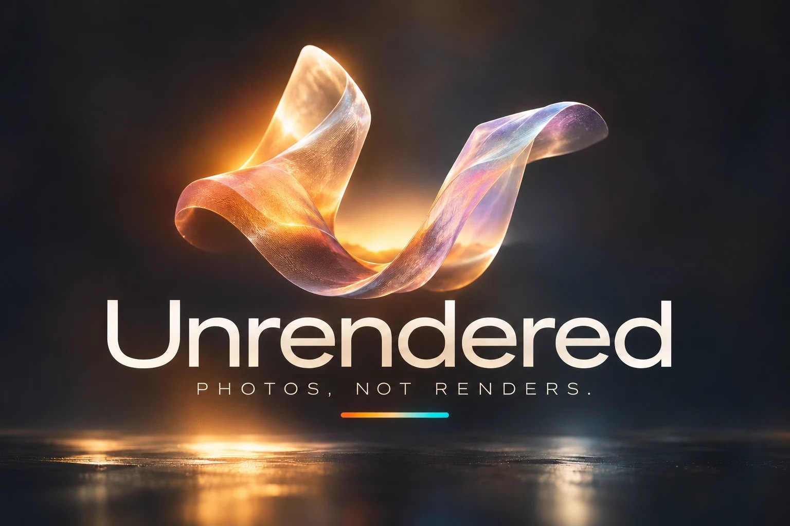
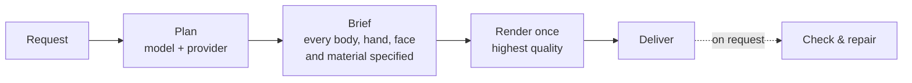

<p align="center">
  
</p>

<h3 align="center">Photorealistic AI images and edits for coding agents.<br>Any image API. The model picked by benchmarks.</h3>

<p align="center"><strong>Stop shipping renders.</strong> Unrendered gives Claude Code, Codex and Cursor a photographer in one skill: it picks the strongest image model from blind-preference leaderboards and writes a brief that leaves the model nothing to guess — every person placed, every hand assigned, every face, material, lens and light written out, the compositions models get wrong designed out — then renders once, at the highest quality, through any image API.</p>

<p align="center">
  <a href="https://mysterxn-ctrl.github.io/unrendered/"></a>
</p>

<p align="center">
  <a href="https://github.com/mysterxn-ctrl/unrendered/actions/workflows/ci.yml"></a>
  <a href="LICENSE"></a>
  <a href="CHANGELOG.md"></a>
  
  <a href="docs/getting-started.md#install"></a>
  
</p>

<p align="center">
  <a href="https://mysterxn-ctrl.github.io/unrendered/"><strong>Website</strong></a> ·
  <a href="docs/getting-started.md"><strong>Get started</strong></a> ·
  <a href="docs/README.md"><strong>Documentation</strong></a> ·
  <a href="docs/how-it-works.md">How it works</a> ·
  <a href="docs/model-selection.md">Model selection</a> ·
  <a href="docs/photorealism.md">Photorealism guide</a> ·
  <a href="docs/faq.md">FAQ</a>
</p>

<p align="center"><sub>Created by <strong>Ruben Ferraro</strong></sub></p>

---

**Unrendered** is an open-source agent skill that teaches Claude Code, Codex, Cursor, OpenCode and other coding agents to create and edit images that look like a person shot them on a real camera. You ask in plain language — *"make a photo of…"*, *"replace the sky in this picture…"* — and the skill does the rest: it picks the best image model from blind-preference leaderboards, turns your sentence into a photographer's brief that specifies every body, hand, face and material, and renders it once at the model's highest quality. Checks and repairs happen when you ask for them.

It works with **any image-generation API** — vendors, gateways, self-hosted endpoints or MCP tools — and decides **by itself** which model to use.

> **Default model: GPT Image 2.6 Sunburst** — for both generation and editing. Every 14 days, at the next image request, Unrendered re-checks the blind-preference leaderboards and switches automatically if another model has taken a clear lead.

<details>
<summary><strong>Contents</strong></summary>

- [Render vs. photo](#render-vs-photo)
- [Why API images look rendered](#why-api-images-look-rendered)
- [Features](#features)
- [Quick start](#quick-start)
- [How it works](#how-it-works)
- [From one line to a brief](#from-one-line-to-a-brief)
- [Documentation](#documentation)
- [Repository layout](#repository-layout)
- [Responsible use](#responsible-use)
- [Contributing](#contributing)
- [License and credit](#license-and-credit)

</details>

## Render vs. photo

Same scene, same checklist. Only one of them can be read.

<table>
<tr>
<th width="50%">Render</th>
<th width="50%">Photo</th>
</tr>
<tr>
<td></td>
<td></td>
</tr>
<tr>
<td>Duplicated and misplaced arms and hands in impossible positions, grey bars instead of words, a chart with nothing to read, smooth AI-sloppy surfaces and one cinematic colour grade over every surface.</td>
<td>Every arm and hand belongs to a visible person in a natural pose, and the checklist is readable: <em>Strategische Analyse</em>, Marktpotenziale, Wettbewerbsanalyse, Wachstumsstrategie, Risikobewertung, Investitionsbedarf, Umsetzungsplan. Soft window daylight, natural colours, real textures and everyday clutter: espresso cup, water glass, phone, laptop, watches.</td>
</tr>
</table>

<p align="center"><sub>Both images were generated with GPT Image 2.6. Compare them with the slider on the <a href="https://mysterxn-ctrl.github.io/unrendered/#finish">website</a>.</sub></p>

## Why API images look rendered

The same image model often looks brilliant inside a chat app and flat through the API. The model is identical; the pipeline is not. Chat apps rewrite your prompt, plan and pick quality for you — a raw API call ships your one-liner at whatever default the gateway uses.

| Raw API call | With Unrendered |
|---|---|
| Your one-liner reaches the model verbatim | A photographer's brief: who shot it, which lens, which light, which imperfections |
| Whatever quality the gateway defaults to — sometimes `low` or `medium` | Every render at the model's highest quality and complexity |
| Hands, poses and faces left to chance | Every person placed, every hand given a side, a task and a grip, every expression written out — before the render |
| Compositions models are known to get wrong | Designed out up front: disembodied hands, people tangled together, crowds in focus, garbled text |
| A model you picked once and hope is still the best | The model chosen from blind-preference leaderboards, automatically |
| Code tied to one vendor's SDK | Any API, gateway or agent tool through JSON profiles |
| Edits that quietly change the whole picture | A dedicated edit track that protects everything you didn't ask to change |

## Features

- **Autonomous, benchmark-based model choice.** Reads the [Artificial Analysis](https://artificialanalysis.ai/image/leaderboard/text-to-image) blind-preference arenas, with [LMArena](https://arena.ai/leaderboard/text-to-image) as an optional second opinion, and switches only on a statistically clear lead: larger than both 95 % confidence intervals combined, or at least 25 Elo and confirmed by the second board. Generation and editing are decided separately. New models are added automatically. [How it decides →](docs/model-selection.md)
- **Provider-agnostic.** OpenAI-protocol endpoints work out of the box; any other API — sync or async, JSON or multipart, base64 or URL results, separate edit endpoints — is a small JSON profile your agent writes from the provider's docs. [Providers →](docs/providers.md)
- **Photographer-grade briefs.** Light with direction and colour temperature, optics that match the framing, real skin and wear, one to three capture artifacts, twenty genre recipes — and none of the "8k masterpiece" vocabulary that pulls images toward CGI. [Photorealism guide →](docs/photorealism.md)
- **One-shot briefs built around what gives AI images away: limbs, pose, facial expression, texture and optics.** Risky compositions are designed out before writing; every person is placed, every visible hand gets a side, a task and a grip, expressions are written as eyes, brows, mouth and gaze, and the brief is checked for contradictions — in text, before the one render. No inspection pass afterwards unless you ask. [Photorealism guide →](docs/photorealism.md)
- **Highest quality, always.** Every render and edit is sent at the model's highest quality and complexity — never a gateway default.
- **Checks and repairs on request.** Point out a flaw, or ask for a check: enlarged tiles of every region, a rubric for limbs, pose, expression, texture and optics, and targeted repair. [QA rubric →](docs/quality-assurance.md)
- **Surgical edits.** Edit-specific model and endpoint; masks and invariants restated on every turn. [Editing →](docs/editing.md)
- **Zero dependencies for the core.** Python 3.9+ standard library. Keys only from environment variables.

## Quick start

### 1 · Install

**Claude Code** (plugin, recommended):

```text
/plugin marketplace add mysterxn-ctrl/unrendered
/plugin install unrendered@unrendered
```

**Codex, Cursor, OpenCode and other agents** ([skills CLI](https://github.com/vercel-labs/skills)):

```bash
npx skills add mysterxn-ctrl/unrendered
```

**Manual:** copy [`skills/unrendered/`](skills/unrendered) to `~/.claude/skills/`, `~/.agents/skills/` or wherever your agent loads skills. [All options →](docs/getting-started.md#install)

### 2 · Connect an image API

If your service speaks the OpenAI-style Images protocol:

```bash
export IMAGE_API_BASE_URL="https://your-image-service.example/v1"
export IMAGE_API_KEY="your-key"
```

For anything else, ask your agent *"Connect Unrendered to &lt;provider&gt;"* — it writes the profile from the provider's documentation. [Details →](docs/providers.md)

### 3 · Ask

> Make a photo of an old fisherman mending a net on a pier at dawn.

> Replace the sky in `beach.jpg` with heavy overcast. Keep everything else identical.

## How it works



1. **Plan** — `model_select.py plan` picks the benchmark-best model that one of your providers actually serves.
2. **Brief** — the request becomes a photographer's brief: risky compositions designed out, every person placed, every hand assigned, expressions, materials, lens and light written out, checked for contradictions in text.
3. **Render once** — at the model's highest quality and complexity, with a sidecar file that records the full request.
4. **Deliver** — the image, with model, settings and the brief.

Ask for a check, or point out a flaw, and the skill inspects the image in enlarged tiles and repairs it with a targeted edit or a corrected brief.

[Full walkthrough →](docs/how-it-works.md)

## From one line to a brief

<table>
<tr><th width="28%">You say</th><th>The model receives</th></tr>
<tr>
<td valign="top"><em>"A man drinking coffee."</em></td>
<td>

```text
Photographer & purpose: candid documentary photo taken by a friend across the table.
Scene: small neighbourhood café, grey November morning, rain-speckled window,
a crumpled sugar wrapper and half a croissant on a scratched wooden table.
Subject: man in his late 40s, salt-and-pepper beard, pilled navy merino sweater.
Bodies & pose: one person, seated alone; right elbow on the table, right hand holds
the cup by its handle just below his mouth; left hand flat beside the saucer.
Face & expression: lips pursed to blow on the coffee, eyes half-lowered towards
the window, brows relaxed, a still-tired early-morning look.
Camera & capture: 50 mm at f/2.8, 1/125 s, ISO 1600; focus on the near eye.
Light: overcast window light from camera left (~6500 K), faint warm pendant behind.
Texture & realism: visible pores, stray beard hairs, pilled wool, worn wood grain,
faint steam, slight grain.
Avoid: airbrushed skin, glossy commercial look, cinematic grade, watermark.
```

</td>
</tr>
</table>

## Documentation

| Guide | What's inside |
|---|---|
| [Getting started](docs/getting-started.md) | Install, connect an API, first image and edit |
| [How it works](docs/how-it-works.md) | The pipeline and why raw API images look worse |
| [Model selection](docs/model-selection.md) | The autonomous, benchmark-based decision system |
| [Providers](docs/providers.md) | Connect any image API or agent tool |
| [Photorealism guide](docs/photorealism.md) | How to make AI images look like real photos |
| [Editing](docs/editing.md) | The edit track, briefs, masks and common edits |
| [Quality assurance](docs/quality-assurance.md) | Checks and repairs on request: rubric and repair map |
| [CLI reference](docs/cli-reference.md) | Every script, option and exit code |
| [Configuration](docs/configuration.md) | Registry, snapshots, provider-profile schema |
| [FAQ](docs/faq.md) | Common questions |
| [Brand assets](docs/brand.md) | Logos, colours, typography |

## Repository layout

```text
.claude-plugin/          plugin + marketplace manifests (Claude Code)
skills/unrendered/
├── SKILL.md             the workflow the agent follows
├── references/          photorealism playbook, genres, brief compiler, QA, editing, providers, model selection
├── scripts/             imagegen.py · model_select.py · qa_tiles.py · contact_sheet.py · photo_finish.py
├── providers/           generic OpenAI-protocol profile + template
├── models.json          model registry (seed)
└── benchmarks/          leaderboard snapshots (seed)
docs/                    documentation
website/                 website on GitHub Pages (landing page + docs)
tools/                   Markdown link checker
tests/                   offline test suite
assets/brand/            logos, icons, social images (not open-source licensed)
```

## Responsible use

Unrendered aims for images that *look* real — it does not help pass them off as real. It never strips or forges provenance data (such as C2PA) or invents camera metadata, and it declines photoreal depictions of real private individuals without consent, fabricated evidence and fake news events.

## Contributing

Issues and pull requests are welcome — new provider profiles, prompt-dialect notes for new models, genre recipes and QA findings especially. Start with [CONTRIBUTING.md](CONTRIBUTING.md). Security reports: see [SECURITY.md](SECURITY.md).

If Unrendered saves you from one more plastic-looking render, a ⭐ helps others find it.

## License and credit

Unrendered is created and maintained by **Ruben Ferraro**.

- Code and documentation: [Apache License 2.0](LICENSE). Redistributions must keep the [NOTICE](NOTICE) file.
- The license does not cover the name "Unrendered", the logo or the ribbon mark (Apache License, Section 6).
- Brand assets in [`assets/brand/`](assets/brand) are not open-source licensed: see [LICENSE.md](assets/brand/LICENSE.md).

When you build on Unrendered, please credit it as:

```text
Unrendered by Ruben Ferraro — https://github.com/mysterxn-ctrl/unrendered
```

<p align="center"><sub><strong>Unrendered</strong> — Photos, not renders. · © 2026 Ruben Ferraro</sub></p>
