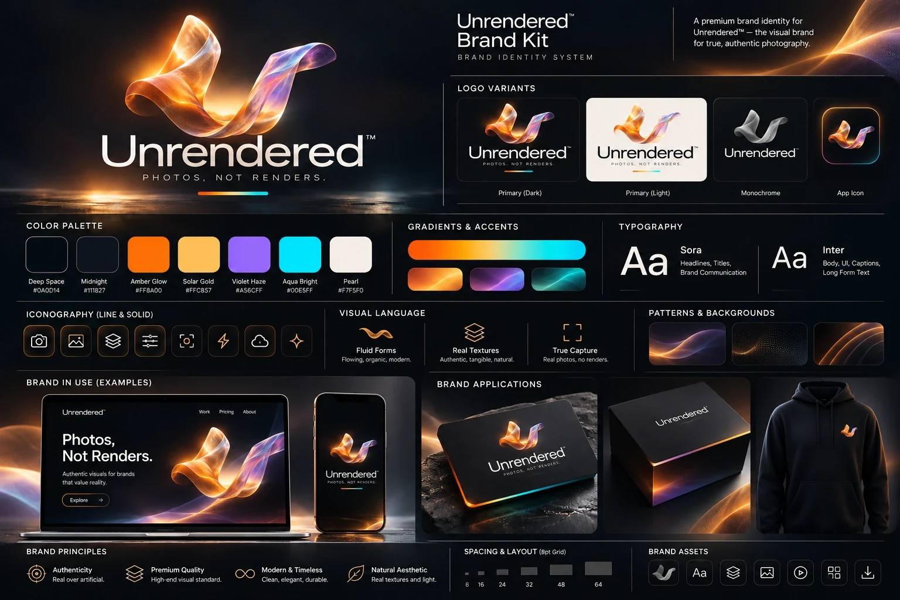

# Brand assets

Logos, colours and typography for articles, talks and "works with Unrendered" mentions.

> **Licensing.** The brand assets are **not** covered by the Apache License 2.0. They are © 2026 Ruben Ferraro, all rights reserved. Using them unchanged to refer to Unrendered is fine; anything else needs permission. See [assets/brand/LICENSE.md](../assets/brand/LICENSE.md) and the [trademark policy](../TRADEMARKS.md).

## Files

| File | Use |
|---|---|
| [`logo-on-dark.png`](../assets/brand/logo-on-dark.png) · [`.webp`](../assets/brand/logo-on-dark.webp) | Full logo for dark backgrounds |
| [`logo-on-light.png`](../assets/brand/logo-on-light.png) · [`.webp`](../assets/brand/logo-on-light.webp) | Full logo for light backgrounds |
| [`mark.png`](../assets/brand/mark.png) · [`.webp`](../assets/brand/mark.webp) | The ribbon mark alone |
| [`icon-512.png`](../assets/brand/icon-512.png) | Square icon, 512 × 512 |
| [`hero.jpg`](../assets/brand/hero.jpg) | Hero artwork |
| [`social-preview.png`](../assets/brand/social-preview.png) | Social card for link previews, 1280 × 640 |
| [`brand-kit.webp`](../assets/brand/brand-kit.webp) | Brand kit overview |

Keep clear space around the logo of at least the height of the "U". Don't recolour the ribbon, stretch the logo or place it on busy backgrounds.

## Colours

| Name | Hex | Role |
|---|---|---|
| Deep Space | `#0A0D14` | primary background |
| Midnight | `#111827` | surfaces |
| Amber Glow | `#FF8A00` | accent, gradient start |
| Solar Gold | `#FFC857` | accent |
| Violet Haze | `#A56CFF` | accent |
| Aqua Bright | `#00E5FF` | accent, gradient end |
| Pearl | `#F7F5F0` | text on dark |

Signature gradient: Amber Glow → Solar Gold → Aqua Bright.

## Typography

- **Sora** — headlines, titles, brand communication
- **Inter** — body text, UI, captions

Both are open-source typefaces under the SIL Open Font License.

## Name and tagline

**Unrendered** — one word, capital U. Tagline: **Photos, not renders.** Created by **Ruben Ferraro**.
