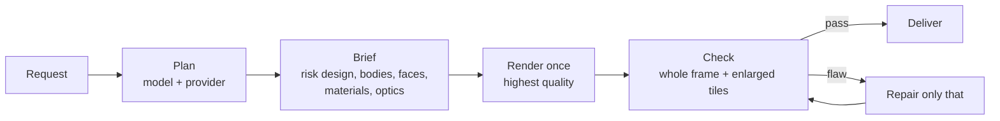

# How it works

## Why raw API images look worse than chat-app images

The same image model often produces noticeably better pictures inside a consumer chat app than through a plain API call. The model is not the difference — the pipeline around it is:

| Inside a chat app | Plain API call |
|---|---|
| A language model rewrites your short request into a long, detailed image prompt | Your one-liner reaches the image model verbatim |
| Optional planning ("thinking"), sometimes several candidates and a self-check | One shot, no review |
| Quality and size chosen for you | Gateway defaults — often `low` or `medium` quality |

Unrendered does that rewriting explicitly — and far more precisely than a generic prompt expander: it designs out the compositions models get wrong, writes every person, hand, face, material, lens and light into the brief, checks the brief for contradictions in text, renders once at the highest quality, and picks the model from blind-preference benchmarks. The image is then checked region by region; because the brief carries the quality, that check rarely finds anything to repair.

## The pipeline

### 0 · Connect

The skill looks for a provider the user has configured: a profile, environment variables for an OpenAI-protocol endpoint, an existing integration in the project, or an agent tool (MCP) that generates images. Nothing is hard-coded. → [Providers](providers.md)

### 1 · Plan — model, provider, settings

`model_select.py plan --task generate|edit` refreshes leaderboard data when it is older than 14 days, applies a fixed statistical rule to decide the best model per track, then walks the ranking until it finds a model that one of your providers really serves. It returns the model, the provider, the provider's model id and the model's quality levels. → [Model selection](model-selection.md)

### 2 · Brief — where the result is decided

The image model renders the brief literally and fills every gap with its own average — a glossy look, a generic face, limbs it invents. So the brief leaves no gap:

- **Risk design first.** Without changing what you asked for, the skill picks the version of the picture a model renders reliably: hands always with a visible owner, at most two people in contact, at most three people in focus, stable poses, grips named exactly, no interlaced fingers, text only when asked and then quoted and short, screens dark or simple.
- **Who** took the photo and why (a friend's phone snapshot, a photojournalist, a studio product shooter).
- **Scene** with a specific place, time, weather and counted objects.
- **Bodies & pose:** one block per person — position in the frame, weight and support, what the right and the left hand each do and how they grip, where limbs leave the frame.
- **Face & expression:** the moment written as eyes, brows, mouth and gaze target, never just "smiling".
- **Camera & capture:** focal length, aperture, shutter, ISO — and the depth of field that follows from them.
- **Light:** one motivated key source, its direction and colour temperature, where shadows fall.
- **Texture:** each main material with its texture and wear; one to three believable capture artifacts.
- **Avoid:** style only — airbrushed skin, CGI look, cinematic grade. Anatomy is written as the correct state, never as a list of errors to avoid.

Before the render the brief is read once against a pre-flight checklist: people counted, every hand assigned, no contradictions between lens and blur or light and shadows, exact text quoted. That check is text only and costs no image tokens. → [Photorealism guide](photorealism.md)

### 3 · Render once

One image at the model's highest quality and complexity — for GPT Image 2.6 Sunburst `quality=max`, `complexity=high` — at a native size. The runner never falls back to a gateway default. Every image gets a sidecar JSON with the full request, so the same call can be repeated.

### 4 · Check

Right after the render the agent checks the image like a photo editor hunting for fakes, in two passes: the whole frame — counting people and tracing every arm and hand to one body — and enlarged, overlapping tiles from `qa_tiles.py` that cover the image edge to edge, so a wrong finger, a stray arm at the border or garbled small text is seen at full detail. Limbs, pose, facial expression, texture and optics come first, then light, colour, text and composition. An image passes only with no hard fail, **8.5 / 10 overall and at least 8 in each of limbs, pose, expression, texture and optics**. → [Quality assurance](quality-assurance.md)

### 5 · Repair — only what the check found

- a wrong or extra limb, a stiff or impossible pose → the brief is corrected (fewer visible hands, every hand assigned, a simpler pose) and rendered again,
- a single hand, expression, skin area or sign → a masked edit that restates everything else.

At most three rounds, each checked again. Whatever the brief missed is noted, so the next brief prevents it.

### 6 · Deliver

The agent reports the file path, model, provider, settings, brief and check result. An optional finishing pass adds subtle grain, lens vignetting and highlight roll-off if an image still looks too clean.

## Design principles

1. **Evidence over opinion.** Models are chosen by blind-preference benchmarks with confidence intervals, not by hype.
2. **No vendor lock-in.** Providers are data (JSON profiles), not code.
3. **Right the first time, checked anyway.** The brief carries the quality and every render uses the model's top level; the check afterwards confirms it and repairs only what it finds.
4. **One change per iteration.** Repairs stay controllable and reproducible.
5. **Realism is an aesthetic, not a disguise.** Provenance data is never stripped or forged.
