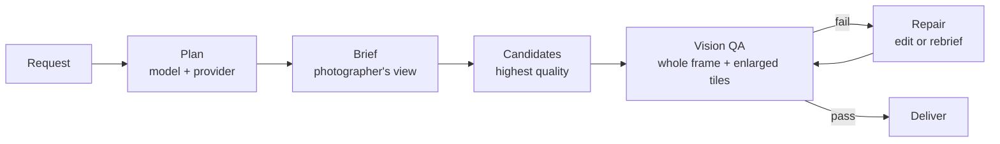

# How it works

## Why raw API images look worse than chat-app images

The same image model often produces noticeably better pictures inside a consumer chat app than through a plain API call. The model is not the difference — the pipeline around it is:

| Inside a chat app | Plain API call |
|---|---|
| A language model rewrites your short request into a long, detailed image prompt | Your one-liner reaches the image model verbatim |
| Optional planning ("thinking"), sometimes several candidates and a self-check | One shot, no review |
| Quality and size chosen for you | Gateway defaults — often `low` or `medium` quality |

Unrendered makes every one of those steps explicit, and adds what neither does by default: a photographer's view of the scene, physical consistency checks, a realism-specific QA rubric, targeted repair, and benchmark-driven model choice.

## The pipeline

### 0 · Connect

The skill looks for a provider the user has configured: a profile, environment variables for an OpenAI-protocol endpoint, an existing integration in the project, or an agent tool (MCP) that generates images. Nothing is hard-coded. → [Providers](providers.md)

### 1 · Plan — model, provider, settings

`model_select.py plan --task generate|edit` refreshes leaderboard data when it is older than 14 days, applies a fixed statistical rule to decide the best model per track, then walks the ranking until it finds a model that one of your providers really serves. It returns the model, the provider, the provider's model id and the model's quality levels. → [Model selection](model-selection.md)

### 2 · Brief — think like the person behind the camera

The request is compiled into a structured brief:

- **Who** took the photo and why (a friend's phone snapshot, a photojournalist, a studio product shooter).
- **Scene** with a specific place, time, weather and mundane clutter.
- **Subject** doing something concrete, with real skin, asymmetry and worn materials.
- **Bodies & pose**: every person counted and placed, every visible hand given a side and a task, weight and support described — this is where wrong limbs and stiff poses are prevented.
- **Face & expression**: the moment written as eyes, brows, mouth and gaze target, never just "smiling".
- **Camera & capture**: focal length, aperture, shutter, ISO — and the depth of field that follows from them.
- **Light**: one motivated key source, its direction and colour temperature; what clips.
- **Imperfections**: one to three believable capture artifacts.
- **Avoid**: the AI look in plain words — and none of the "AI-art" vocabulary (`8k`, `hyperrealistic`, `masterpiece`…) that pulls images toward glossy CGI.

→ [Photorealism guide](photorealism.md)

### 3 · Candidates

Three candidates by default (one for a quick look, up to six for hero work), every one at the model's highest quality and complexity — for GPT Image 2.6 Sunburst `quality=max`, `complexity=high` — at a native size. The runner never falls back to a gateway default: if a model's quality levels are unknown, it stops until they are added. Every image gets a sidecar JSON with the full request, so the same call can be repeated.

### 4 · Vision QA

The agent looks at every candidate twice: as a whole frame, counting people and tracing every arm and hand to one body, and as enlarged, overlapping tiles from `qa_tiles.py` that cover the image edge to edge — so a wrong finger, a stray arm at the border or garbled small text is seen at full detail. Limbs, pose, facial expression, texture and optics are checked first, then light, colour, text and composition — ten weighted criteria in all. Hard fails such as duplicated or misplaced limbs, impossible poses, dead or mismatched eyes, waxy skin, gibberish text, contradictory shadows or fused objects disqualify a candidate regardless of score. An image ships only with no hard fail, **8.5 / 10 overall and at least 8 in each of limbs, pose, expression, texture and optics**. → [Quality assurance](quality-assurance.md)

### 5 · Repair

At most three rounds, one change at a time:

- local defects (a hand, a sign, a stray object) → a masked or tightly scoped **edit** that restates every invariant,
- global defects (glossy, staged, flat light) → a **revised brief** and a regeneration.

### 6 · Delivery

The winner is already rendered at the highest quality, so no extra render is needed. An optional finishing pass adds subtle grain, lens vignetting and highlight roll-off if an image still looks too clean. The agent reports file paths, model, provider, settings, brief and QA result.

## Design principles

1. **Evidence over opinion.** Models are chosen by blind-preference benchmarks with confidence intervals, not by hype.
2. **No vendor lock-in.** Providers are data (JSON profiles), not code.
3. **Highest quality, never unchecked.** Every render uses the model's top level, and every image is inspected region by region before it is delivered.
4. **One change per iteration.** Repairs stay controllable and reproducible.
5. **Realism is an aesthetic, not a disguise.** Provenance data is never stripped or forged.
